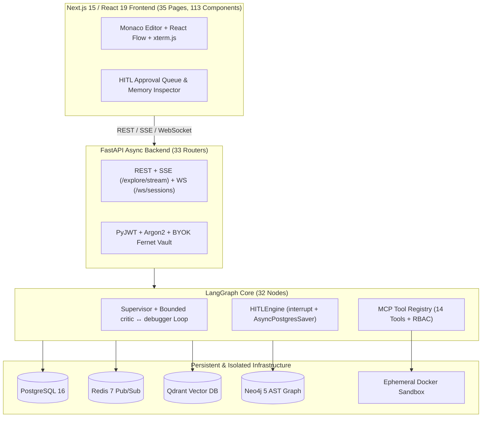

# ASEP — Autonomous Software Engineering Platform

<div align="center">


```

█████╗ ███████╗███████╗██████╗
██╔══██╗██╔════╝██╔════╝██╔══██╗
███████║███████╗█████╗  ██████╔╝
██╔══██║╚════██║██╔══╝  ██╔═══╝
██║  ██║███████║███████╗██║

╚═╝  ╚═╝╚══════╝╚══════╝╚═╝

```

### **Stateful Multi-Agent Software Engineering Platform with Sandboxed Execution & HITL Governance**

*Orchestrate bounded 32-node LangGraph workflows, enforce Human-in-the-Loop approval interrupts backed by PostgreSQL checkpoints, and execute untrusted code inside hardened ephemeral Docker sandboxes.*

---

[[https://github.com/rounakkumarsah/ASEP/actions/workflows/push-main.yml/badge.svg]](https://github.com/rounakkumarsah/ASEP/actions)
[[https://img.shields.io/badge/Next.js-15.5.23-black?style=flat&logo=next.js]](https://nextjs.org/)
[[https://img.shields.io/badge/FastAPI-0.115+-009688?style=flat&logo=fastapi]](https://fastapi.tiangolo.com/)
[[https://img.shields.io/badge/LangGraph-32_Nodes-FF6F00?style=flat]](https://github.com/langchain-ai/langgraph)
[[https://img.shields.io/badge/Tests-706_Passing-16A34A?style=flat]](https://github.com/rounakkumarsah/ASEP/actions)
[[https://img.shields.io/badge/PostgreSQL-16-336791?style=flat&logo=postgresql]](https://www.postgresql.org/)
[[https://img.shields.io/badge/Qdrant-Vector_Search-DC2626?style=flat]](https://qdrant.tech/)
[[https://img.shields.io/badge/Neo4j-Graph_AST-008CC1?style=flat&logo=neo4j]](https://neo4j.com/)
[[https://img.shields.io/badge/Docker-Hardened_Sandbox-2496ED?style=flat&logo=docker]](https://www.docker.com/)
[[https://img.shields.io/badge/License-MIT-blue.svg]](LICENSE)

[Architecture Specs](docs/sales_package/01_TECHNICAL_ARCHITECTURE.md) • [Deployment Guide](docs/DEPLOYMENT_GUIDE.md) • [CI Workflows](.github/workflows/)

</div>

---

## 1. Overview & Verified Engineering Scope

**ASEP** transforms engineering objectives into verified code using a **32-node LangGraph StateGraph** across **33 FastAPI router modules** and a **Next.js 15 / React 19** workspace (React Flow, Monaco Editor, xterm.js).

- **Bounded Self-Healing Runtime:** Dynamic `phase_router()` manages `critic ↔ debugger` self-healing loops with strict step and token bounds to prevent infinite execution.
- **Non-Blocking HITL Governance:** High-risk actions (`filesystem.delete`, `terminal`, `docker`) pause via LangGraph `interrupt()` and persist state in PostgreSQL (`AsyncPostgresSaver`), freeing FastAPI worker threads until resumed via `POST /api/v1/hitl/sessions/{id}/decision`.
- **Hardened Ephemeral Code Sandbox:** Untrusted execution runs in isolated Docker containers (`network_mode="none"`, `read_only=True`, `cap_drop=["ALL"]`, `no-new-privileges`, `50MB` RAM, `0.5` CPU, `50` PIDs, 5s watchdog) with an AST-based `RestrictedPython` fallback.
- **3-Tier Hybrid Memory & Telemetry:** Combines PostgreSQL (ACID state & checkpoints), Qdrant (semantic vector embeddings), Neo4j (code AST call-graph), and Redis (caching, rate-limiting, WebSocket PTY pub/sub relay).
- **Verified Quality & DevSecOps:** **706 passing automated tests** (555 `pytest` backend + 151 `Vitest` frontend) and **7 CI security gates** (`pip-audit`/`Bandit`, `npm audit`, `Semgrep`, `CodeQL`, `Gitleaks`, `Trivy`, `Cosign` SLSA provenance).

---

## 2. Visual Previews

### 2.1 Platform Control Plane
[docs/images/landing.png]

### 2.2 Live Workspace, Task Stream & HITL Approvals
[docs/images/dashboard.png]

---

## 3. System Architecture



---

## 4. Quick Start

### 4.1 Docker Compose (Recommended)

```bash
git clone [https://github.com/rounakkumarsah/ASEP.git](https://github.com/rounakkumarsah/ASEP.git)
cd ASEP

cp backend/.env.example backend/.env
cp .env.example frontend/.env.local

docker compose up -d --build

```

* **Frontend Workspace:** `http://localhost:3000`
* **Backend API & Docs:** `http://localhost:8000/docs`
* **Cold Start Readiness:** First startup initializes Postgres, Qdrant, and Neo4j (and caches the ~130 MB embedding model in `~/.cache/huggingface/`). Poll readiness instead of fixed sleeps:

```bash
until curl -sf http://localhost:8000/api/v1/health/ready > /dev/null; do
  echo "Waiting for ASEP..."
  sleep 2
done

```

### 4.2 Local Development

```bash
cd backend
python -m venv .venv
source .venv/bin/activate  # Windows: .venv\Scripts\activate
pip install -r requirements.txt
python -m alembic upgrade head
uvicorn src.main:app --reload --port 8000

```

```bash
cd frontend
npm install
npm run typecheck && npm run lint
npm run dev

```

---

## 5. Security, BYOK & Production Guardrails

* **BYOK Encrypted Credential Vault:** Users can configure personal API keys (Gemini, Anthropic, OpenAI, Groq, OpenRouter) encrypted at rest with `Fernet` (`ASEP_KEY_VAULT_SECRET`), with platform-level fallback.
* **Fail-Fast Environment Validation:** In `staging`/`production`, a Pydantic `model_validator` blocks startup if `DATABASE_URL`, `REDIS_URL`, or `SECRET_KEY` still contain localhost or default placeholder values.
* **Multi-Stage Non-Root Containers:** Both `backend/Dockerfile` (`asepuser`) and `frontend/Dockerfile` (`nextjs`, `.next/standalone`) run as unprivileged users.

---

## 6. Automated Tests & CI Security Gates

```bash
# Backend (555 passing pytest cases across 101 test files)
cd backend && pytest -v

# Frontend (151 passing Vitest cases across 15 suites)
cd frontend && npm test && npm run typecheck && npm run lint

```

CI (`.github/workflows/security-scan.yml`) runs **7 automated gates**: `pip-audit` & `Bandit`, `npm audit` & `tsc`, `Semgrep SAST`, `CodeQL`, `Gitleaks`, `Trivy`, and `Cosign` SLSA Build Level 2 image attestation.

---

## 7. Author & License

* **Author:** Rounak Kumar Sah ([@rounakkumarsah](https://github.com/rounakkumarsah) • [LinkedIn](https://www.linkedin.com/in/rounak-kumar-sah))
* **License:** [MIT License](https://www.google.com/search?q=LICENSE)


